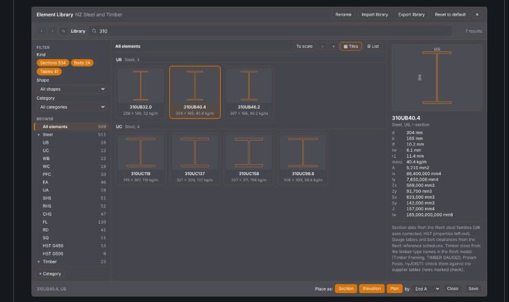

# PDF43

The **Seed43** extension for [Open PDF Studio](https://github.com/OpenAEC-Foundation/open-pdf-studio): drawing and markup tools for structural and building work, in one add-on. (This repository is called PDF43; in the app it is Seed43.)

Each tool can be switched on or off on the **Seed43** ribbon tab, and the choice is remembered. Most of them live in the **Seed43 Properties** drawer at the side of the page: its tabs are **Properties**, **Elements**, **Stamps** and **Collab**.

| Tool | What it does |
|---|---|
| **Element Library** | Steel, timber, fixings and bolt groups placed to scale from an editable library, with snapping and grips |
| **Smart Stamps** | Stamps, drawing sheets and memos built like Revit families, with shared and per-sheet values, and the Stamp Builder |
| **Collab** | Share a PDF by key and mark it up together, live, with up to three people |
| **Auto Link** | Links section and detail bubbles to each other, both ways |
| **Bracing** | Bracing legend lines with their type and length in metres |
| **Paddle OCR** | A local OCR engine for scans and page labels |

## Element Library

**Seed43 › Element Library** opens the library window: 3,500 steel, timber, fixing and bolt elements for **Australia**, **New Zealand**, **South Africa** and the **United Kingdom** (UB, UC, WB, WC, PFC, angles, hollow sections, bars, purlins, sawn and gauged timber, Prolam posts, hyJOIST I-joists, MiTek Lumberlok and Bowmac fixings, bolts and gauge tables). The **Elements** tab of the drawer finds and places the same elements without opening the window.



- **Find:** type in the search box (names and sizes: `310UB`, `90x45`, `M20`, `JH47x90`, `B21`), or browse by country on the left. **Countries** chooses which countries show. Back, forward and home work like a file browser.
- **Look:** tiles with a preview of each element (**To scale** draws them to one common scale; **−** and **+** change the tile size), or **List** for the table. Select an element to see its preview and properties on the right.
- **Edit:** in List view: add, duplicate or delete rows and columns, **Import CSV** (paste a table from Excel), or delete a category. Ctrl+S saves.
- **Place:** **Place as section**, Enter, or double-click a tile; a member offers **Section**, **Elevation** and **Plan**, a bolt group **Face**, **Plan** and **Elevation**.
- **Missing something?** **Request a library** asks for one for your country or supplier.

On the sheet:

- **Sections, fixings and bolt groups:** click to place. Space turns the element by 90 degrees.
- **Members (elevation or plan):** click point A, then point B, like the line tool; a live preview shows the member and its length. Hold **Ctrl** or **Shift** to keep it horizontal or vertical. **by** in the footer sets the grip you place by: End A, Midpoint or End B.
- **Snapping:** points snap to member ends, midpoints and centre lines, and to section and bolt group centres; otherwise the app's own snap (PDF lines, grid) is used.
- **Grips:** select an element to see its grips. Drag an end to stretch a member, the midpoint or centre to move it. One drag is one undo step.
- **Properties:** change the element, its scale, view, label and pieces. Fixings with a maker's drawing (MiTek CAD, drawn 1:1) switch between Plan, Front and Side, or use a simple outline instead. A Multi-Brace strap takes any length.

## Smart Stamps

The **Stamps** tab of the drawer has three tabs, **Stamps**, **Sheets** and **Memos**, with the **Stamp Builder** on the same row.

- **Stamps:** click one, then click on the sheet. Built in: issue status, approved BC drawings, shop drawing review, QA check sets, CPEng design check, date and time, released or revised, RFI reference, inspection, producer statement, superseded or void, page number and more.
- **Sheets:** drawing sheets from A4 to A0, fitted to the page and kept behind every markup. **Add to this page**, **Add to all pages**, or **New PDF** with a number of pages.
- **Memos:** A4 forms such as an RFI, site instruction, site visit report, snag list, transmittal and memo.
- **Families:** like Revit, every stamp or sheet of a kind shares its values (project, client, job number), so one change updates them all; **per sheet** values (drawing number, title, revision) belong to each one.
- **Fill in:** in Properties, or double-click a box on the sheet to type right there.
- **Revisions:** kept as a list. The newest is editable, older ones are greyed out, **Add revision** starts the next one, and the sheet shows as many as it has revision rows.
- **My details:** your name, initials, company, CPEng number and signature fill stamps for you. They stay on your computer.
- **QA colours:** pick who you are checking as (Check 1, Check 2, Check 3 or Approved) and every markup you draw takes that checker's colour.

**Stamp Builder:** make or change stamps, sheets and memos, and set My details.

- New stamps as a table, a banner, from a picture, or from an area of the open page.
- **Your company's border:** open its blank border PDF and choose **Sheet from the open page**, either **as is** (a picture) or **smart**: lines and text become sharp vectors, and only real pictures such as a logo stay images. Then drag boxes on it for the values to fill in.
- **Export** and **Import** share your designs as a `.seed43stamps` file.

## Collab

Share a PDF by key and mark it up together. Markups sync live and belong to whoever made them; everyone else's arrive locked. The pages of a shared PDF are locked, so markups always land in the right place. In a shared PDF each seat draws in its own QA colour (seat 1, who shared it, is Check 1; the two who join are Check 2 and Check 3), and the owner can set the colours for everyone. It runs on Seed43's own server, end to end encrypted.

## Auto Link and Bracing

- **Auto Link** reads every page, finds the section and detail bubbles and links each to its partner, both ways, as plain PDF links like the ones Revit exports. Running it again only adds what is missing.
- **Bracing** draws bracing legend lines with their type and length in metres.

## Paddle OCR

Open **Recognize Text (OCR)** and set **Engine** to **Paddle OCR**. It runs PaddleOCR (PP-OCR) locally, finds every text line and turns it upright before reading, so drawings that mix horizontal and vertical text read in one pass. Open PDF Studio then uses it for the searchable text layer, page labels and form recognition, and falls back to its built-in Tesseract if it fails.

## Install

In Open PDF Studio: **File › Extensions › Browse**, find Seed43, **Install**. Or **Add custom** with `https://github.com/Seed-43/PDF43`, or download `seed43.oppx` from the latest release and use **Install from File**. Updates are offered under **Seed43 › About**.

## Build

```bash
npm install
node build.mjs          # dist/seed43.oppx (desktop)
node build.mjs --web    # dist-web/seed43/ (web build, no Collab or OCR)
```

Add a tool: give it a folder under `src/` and an entry in the `TOOLS` list in `src/index.js` (`start(api)` and `stop(api)`).

## Licence

Apache-2.0. The bundled models and ONNX Runtime keep their own licences; see [NOTICE.md](NOTICE.md).
