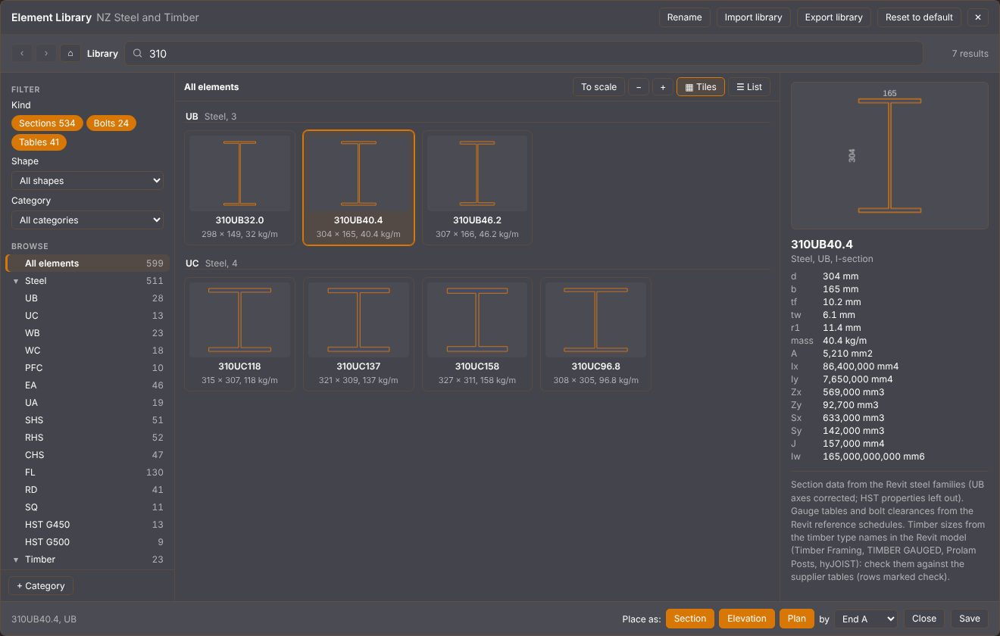

# PDF43

The **Seed43** extension for [Open PDF Studio](https://github.com/OpenAEC-Foundation/open-pdf-studio): tools in one add-on. (This repository is called PDF43; in the app it is Seed43.) Each tool can be switched on or off on the **Seed43** ribbon tab, and the choice is remembered.

| Tool | What it does |
|---|---|
| **Element Library** | Steel and timber sections, members and bolt groups placed to scale from an editable library, with snapping and grips. See below. |
| **Paddle OCR** | Paddle OCR engine: PaddleOCR (PP-OCR) text recognition, running locally. It finds every text line and turns it upright before reading, so drawings that mix horizontal and vertical text, and sheets stored sideways, read in one pass. On a test architectural sheet it read 380 clean words where the built-in Tesseract read 38, and every drawing number in the title blocks correctly. |

## Element Library

**Seed43 > Element Library** opens the library window: NZ Steel and Timber to start (UB, UC, WB, WC, PFC, angles, hollow sections, bars, purlins, sawn and gauged timber, Prolam posts, hyJOIST I-joists, bolts and the NZ gauge tables), which you edit and save like a CAD block library.



- **Find:** type in the search box across the top (names and sizes: `310UB`, `90x45`, `M20`, `H5`); filter by kind, shape and category on the left, or browse the tree (Steel, Timber, Bolts, Reference tables). Back, forward and home work like a file browser; the result count updates as you type.
- **Look:** the main area shows a tile with a preview of each section (**To scale** draws a category to one common scale; **-** and **+** change the tile size), or switch to **List** for the editable table. The details panel on the right shows all fields, a larger preview and the source note. Rows marked check come from type names, not a supplier table.
- **Edit:** in List view (pick a category first): edit cells, add, duplicate or delete rows and columns, **Import CSV** (paste from Excel), rename the category or change its shape. **Save** (Ctrl+S) keeps the library in the app; **Export library** and **Import library** move it between computers; **Reset to default** goes back to the shipped library; **Add new defaults** adds categories that a newer shipped library has and your saved one does not (for example Timber).
- **Place:** **Place as Section / Elevation / Plan** in the footer, Enter, or double-click a tile (section). Bolts: **Place bolt group**. Keyboard: arrow keys move through the tiles, Enter places, Esc closes, Ctrl+F searches.

On the sheet:

- **Sections and bolt groups:** click to place. Space turns the element by 90 degrees.
- **Members (elevation or plan):** click point A, then point B, like the line tool; a live preview shows the member and its length. Press-drag-release also works. Hold **Ctrl** or **Shift** to keep the member horizontal or vertical (both keys: also 45 degrees). Esc cancels after point A. **by** in the footer sets the grip you place by: End A (click A then B), Midpoint (click the middle, then an end) or End B.
- **Snapping:** while placing or dragging a grip, points snap to member ends A and B, midpoints and centre lines, and to section and bolt group centres; a marker and its name show the snap point. Otherwise the app's own snap (PDF lines, grid) is used for the clicked point.
- **Grips:** select an element with the Select tool to see its grips. Drag end A or B to stretch a member (Ctrl or Shift keeps it square), its midpoint to move it, or the centre of a section or bolt group to move it. One drag is one undo step.

What would need a change in the app itself (the app's own tools snapping to Seed43 elements, a two-point draw mode for plug-ins) is written up in [docs/host-changes.md](docs/host-changes.md).

## Install

In Open PDF Studio: **File > Extensions > Browse**, find Seed43, **Install**. Or **Add custom** with `https://github.com/Seed-43/PDF43`, or download `seed43.oppx` from the latest release and use **Install from File**.

**Paddle OCR:** open **Recognize Text (OCR)** and set **Engine** to **Paddle OCR**. The app then uses it for the searchable text layer, page labels and form recognition, and falls back to its built-in Tesseract if it fails. Needs an Open PDF Studio build with the OCR engine slot (`api.features.ocrEngines`).

## Build

```bash
npm install
node build.mjs                      # dist/seed43.oppx
node test/run-node.mjs page.png     # the OCR pipeline in Node, for testing
```

Add a tool: give it a folder under `src/` and an entry in the `TOOLS` list in `src/index.js` (`start(api)` and `stop(api)`).

## Extension catalogue

This repository also holds the shared catalogue that Open PDF Studio reads under **Extensions > Browse**: [`extensions.json`](extensions.json). It works like the pyRevit extensions list.

To add your extension:

1. Publish it in its own GitHub repository.
2. Create a GitHub release with the `.oppx` package attached. The app installs the `.oppx` of the latest release and offers an update when a newer release appears. Use a tag such as `v1.2.0` that matches `version` in your `plugin.json`.
3. Open a pull request that adds one entry to `extensions.json`:

```json
{
  "id": "my-extension",
  "name": "My Extension",
  "description": "One or two sentences on what it does.",
  "author": "Your name",
  "repo": "https://github.com/you/my-extension",
  "tags": ["markup", "measure"]
}
```

| Field | Required | Notes |
|---|---|---|
| `id` | yes | Must match `id` in your `plugin.json`: lower case letters, digits, `.`, `_`, `-` |
| `name`, `description`, `author` | yes | Description up to 400 characters |
| `repo` | yes, unless `package` | `https://github.com/owner/repo`; the latest release's `.oppx` is installed |
| `package` | no | A fixed `https://` link to a `.oppx` instead of `repo` |
| `version` | with `package` | The version `package` installs; an update is offered when it is newer |
| `sha256` | no | SHA-256 of `package`; a download that does not match is refused |
| `homepage`, `tags` | no | `homepage` defaults to `repo`; up to 8 tags |

Pull requests are reviewed before they are merged: the extension should do what its description says, and its source should be public.

**Not listed?** **Extensions > Add custom** installs any extension from a GitHub repository or `.oppx` link, or from a file. These are not reviewed, so only install extensions from people you trust. A company can also keep its own `extensions.json` and add its link under **Browse > Catalogues**.

## Licence

Apache-2.0. The bundled models and ONNX Runtime keep their own licences; see [NOTICE.md](NOTICE.md).
